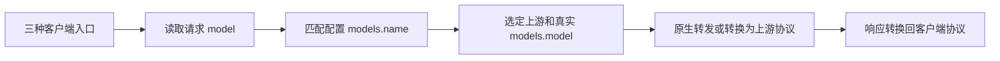

# 多协议 AI 网关

一个按模型配置选路的 Go 网关。客户端可以使用 Anthropic Messages、OpenAI Chat Completions 或 OpenAI Responses；网关根据请求中的公开模型名，找到真实模型 ID 和所属上游，再按上游协议发送请求，最后按客户端协议返回结果。

## 功能

- 三种客户端入口与三种上游协议，可组合成九种基础调用路径，支持普通 JSON 和 SSE 流式响应。
- 多上游、多模型配置：每个上游单独设置地址、密钥和代理，每个公开模型可以映射到不同真实模型 ID。
- 同协议原生转发，保留原生扩展字段；跨协议转换文字、多轮历史、函数工具、工具选择和工具结果。
- 按模型声明启用跨协议图片、JSON Schema 输出、推理参数与可读推理摘要；支持范围见[模型兼容能力](#模型兼容能力)。
- 模型级 Chat token 字段选择，支持 `max_tokens` 与 `max_completion_tokens`。
- 客户端 API Key 鉴权、模型列表、按上游能力提供真实输入 token 计数。
- 请求取消、流式终态与工具参数校验、结构化转换错误，以及可选的请求文件日志。
- 密钥可直接写入 `config.yaml`，不要求使用环境变量；旧单 Responses 上游配置继续兼容。

每次请求只选择一个上游，不自动重试或故障切换，不执行工具。跨协议转换受已实现的能力范围限制，不代表能完整迁移服务商所有原生功能。

## 请求如何选路



| 客户端协议 | 请求入口 | Chat 上游 | Responses 上游 | Anthropic 上游 |
|---|---|---|---|---|
| Chat Completions | `POST /v1/chat/completions` | 原生转发 | 协议转换 | 协议转换 |
| Responses | `POST /v1/responses` | 协议转换 | 原生转发 | 协议转换 |
| Anthropic Messages | `POST /v1/messages` | 协议转换 | 协议转换 | 原生转发 |

这里的九种组合针对基础文字和函数工具的 JSON/SSE。模型能力声明决定跨协议高级功能是否开放。

例如，请求从 `/v1/responses` 进入，`model` 填 `coding`；配置中 `coding` 属于 `chat-main`、真实模型为 `your-chat-model`，网关就请求该服务的 `/chat/completions`，然后返回 Responses 格式。**入口协议不决定上游，公开模型名决定选路。**

`models[].name` 必须全局唯一；客户端填写这个名称。`models[].model` 是发送给上游的真实 ID。找不到公开模型名返回 `400/model_not_found`，不会猜测或改投其他上游。

## 快速开始

### 1. 准备配置

从源码构建需要 Go 1.26.0 或更高版本；部署已构建的二进制时不需要安装 Go。项目依赖 `go.yaml.in/yaml/v4`，其余运行时代码使用标准库。

在项目根目录复制示例，然后编辑 `config.yaml`：

```powershell
Copy-Item config.example.yaml config.yaml
```

也可以将配置精简为下面这个单 Chat 上游示例。替换地址、密钥和真实模型 ID 后，三个入口均可通过公开名 `coding` 调用它：

```yaml
server:
  addr: "127.0.0.1:8176"
  read_header_timeout: "10s"
  shutdown_timeout: "5s"

upstreams:
  chat-main:
    protocol: openai-compatible
    base_url: "https://chat.example.com/v1"
    api_key: "replace-with-your-upstream-key"
    proxy_url: ""
    models:
      - name: coding
        model: "your-chat-model"
        # 若目标模型要求旧 token 字段，再启用：
        # compatibility:
        #   chat_token_limit_field: max_tokens

auth:
  gateway_api_key: "local-test-key"

logging:
  requests:
    enabled: false
    dir: "logs/requests"
```

`api_key` 填真实上游密钥；`auth.gateway_api_key` 是客户端连接本地网关时使用的独立密钥。不需要设置环境变量。`api_key_env` 是可选替代方式，只能填环境变量名，不能填真实密钥，且不能与 `api_key` 同时配置。

`base_url` 填服务实际 API 前缀，网关会追加资源路径。例如 Chat 会追加 `/chat/completions`；不要把这个后缀再次写进基地址。服务有自定义前缀时按其实际地址填写。

`proxy_url: ""` 不启用显式代理，但仍遵循进程的 `HTTP_PROXY`、`HTTPS_PROXY`、`NO_PROXY`。复制[完整示例](config.example.yaml)时，也应检查其中的代理地址是否适合本机。

### 2. 校验并启动

```powershell
go run ./cmd/server --config ./config.yaml --check-config
go run ./cmd/server --config ./config.yaml
```

`--check-config` 只校验本地配置，不监听端口、不访问上游、不创建日志目录；校验成功不表示上游密钥或模型已通过在线验证。普通启动后监听配置的地址，默认是 `127.0.0.1:8176`。

### 3. 连接客户端

| 客户端类型 | 常用基地址 | 实际生成的请求路径 |
|---|---|---|
| OpenAI Chat Completions | `http://127.0.0.1:8176/v1` | `/v1/chat/completions` |
| OpenAI Responses | `http://127.0.0.1:8176/v1` | `/v1/responses` |
| Anthropic Messages | `http://127.0.0.1:8176` | `/v1/messages` |

不同客户端可能自动补 `/v1`，以最终请求路径为准。模型填写配置的公开名，例如 `coding`；客户端密钥填写 `local-test-key`。支持 `Authorization: Bearer ...` 或 `x-api-key`。同协议响应保留上游原生模型名，跨协议响应使用客户端公开模型名。

先查询模型列表，确认本地服务和鉴权可用；多上游模式下这个请求不会访问模型服务：

```powershell
$headers = @{ Authorization = "Bearer local-test-key" }
Invoke-RestMethod -Uri "http://127.0.0.1:8176/v1/models" -Headers $headers
```

再选一个入口验证模型连通性。以下 PowerShell 示例会实际调用配置的上游：

```powershell
$headers = @{ Authorization = "Bearer local-test-key" }
$body = @{
  model = "coding"
  input = "Reply with OK."
  max_output_tokens = 64
} | ConvertTo-Json
Invoke-RestMethod -Method Post `
  -Uri "http://127.0.0.1:8176/v1/responses" `
  -Headers $headers -ContentType "application/json" -Body $body
```

其他入口的请求格式：

```json
{"model":"coding","messages":[{"role":"user","content":"Reply with OK."}],"max_tokens":64}
```

上述 JSON 可用于 `/v1/chat/completions` 和 `/v1/messages`。如需流式输出，增加 `"stream": true`，并使用支持 SSE 的客户端；`Invoke-RestMethod` 示例只演示普通 JSON 请求。

## 部署

### Windows：构建二进制运行

在项目根目录执行：

```powershell
go build -o bin/gateway.exe ./cmd/server
.\bin\gateway.exe --config .\config.yaml --check-config
.\bin\gateway.exe --config .\config.yaml
```

运行时只需要可执行文件和配置文件，可复制到其他目录部署；同时确认配置中的代理和日志目录有效。源码不包含 Windows 服务安装器，上述方式在当前终端运行。停止后再替换二进制，修改配置后重新启动。

### 本地开发：Air 热重载

已安装 Air 时，在项目根目录执行：

```powershell
air -c .\.air.toml
```

直接运行 `air` 也会读取当前目录的 `.air.toml`。仓库配置会重新编译 `cmd/server` 并运行 `tmp/gateway.exe`，监听 Go/YAML 等文件变化，忽略 `logs`、`bin`、`tmp` 和测试文件。Air 用于开发；常驻部署使用构建后的二进制和进程管理器。

### Linux：构建与 systemd 常驻

在 Linux 上用相同源码和配置构建：

```bash
go build -o bin/gateway ./cmd/server
./bin/gateway --config ./config.yaml --check-config
./bin/gateway --config ./config.yaml
```

下面是使用 systemd 的部署示例，需要相应管理权限。先停止上面的前台进程，再准备服务账户、程序和配置；若已存在 `ai-gateway` 账户，跳过创建账户的命令：

```bash
sudo useradd --system --home-dir /opt/ai-gateway --shell /usr/sbin/nologin ai-gateway
sudo install -d -o root -g ai-gateway -m 750 /opt/ai-gateway
sudo install -m 755 bin/gateway /opt/ai-gateway/gateway
sudo install -o root -g ai-gateway -m 640 config.yaml /opt/ai-gateway/config.yaml
sudo install -d -o ai-gateway -g ai-gateway -m 750 /opt/ai-gateway/logs
sudo -u ai-gateway /opt/ai-gateway/gateway --config /opt/ai-gateway/config.yaml --check-config
```

将下面内容保存为 `/etc/systemd/system/ai-gateway.service`：

```ini
[Unit]
Description=Multi-protocol AI gateway
Wants=network-online.target
After=network-online.target

[Service]
Type=simple
User=ai-gateway
Group=ai-gateway
WorkingDirectory=/opt/ai-gateway
ExecStart=/opt/ai-gateway/gateway --config /opt/ai-gateway/config.yaml
Restart=on-failure
RestartSec=3
KillSignal=SIGINT
TimeoutStopSec=10

[Install]
WantedBy=multi-user.target
```

当前程序使用 `SIGINT` 触发优雅关闭，因此服务示例显式指定 `KillSignal=SIGINT`。`TimeoutStopSec` 应大于配置的 `server.shutdown_timeout`。日志相对配置文件目录解析；若启用默认请求日志，服务账户应能写入 `/opt/ai-gateway/logs/requests`。

```bash
sudo systemctl daemon-reload
sudo systemctl enable --now ai-gateway
sudo systemctl status ai-gateway
sudo journalctl -u ai-gateway -f
```

修改配置或替换程序后执行 `sudo systemctl restart ai-gateway`。直接访问网关时，将 `server.addr` 设置为实际需要的监听地址，例如 `0.0.0.0:8176`；通过本机反向代理访问时可以保留 `127.0.0.1:8176`。对外提供访问时设置独立的 `auth.gateway_api_key`。

### 反向代理与 SSE

网关本身提供 HTTP 服务，HTTPS 可由反向代理终止。以下是 Nginx `server` 配置片段，可合并到现有站点配置中：

```nginx
server {
    listen 8080;
    client_max_body_size 16m;

    location / {
        proxy_pass http://127.0.0.1:8176;
        proxy_http_version 1.1;
        proxy_set_header Host $host;
        proxy_set_header Connection "";
        proxy_buffering off;
        proxy_cache off;
        proxy_read_timeout 3600s;
    }
}
```

`proxy_buffering off` 让 SSE 增量及时到达客户端；`proxy_read_timeout` 是两次读取之间的空闲超时，可按实际流式调用时长调整。客户端的鉴权头仍传给网关。仓库目前没有 Dockerfile 或 Compose 文件，上述部署直接使用二进制。

## 配置说明

### 配置文件规则

配置文件选择：`--config <路径>` > 非空 `GATEWAY_CONFIG` > 当前工作目录 `config.yaml`。显式指定的文件不存在即失败；默认文件不存在时允许仅靠环境变量启动。

旧单上游字段优先级：**已设置的环境变量 > YAML 显式字段 > 内置默认值**。新配置使用 `upstreams`，每个服务的密钥可直接使用 `api_key`，也可通过 `api_key_env` 显式读取环境变量，完整字段与注释见 [config.example.yaml](config.example.yaml)。不自动加载 `.env`，不做 `${VAR}` 插值。

- 字段缺省沿用默认值；显式 `false`、空字符串、`[]`、`{}` 保留原意。映射和列表整体替换，不做深度合并。
- 空环境变量会覆盖文件值：空 `OPENAI_MODEL` 清除固定模型，空 `GATEWAY_API_KEY` 关闭本地鉴权，空集合变量清空集合；空 `OPENAI_API_KEY`、`GATEWAY_ADDR`、`OPENAI_BASE_URL` 校验失败。
- `upstream.proxy_url: ""` 或空 `OPENAI_PROXY_URL` 取消显式代理，仍遵循标准库 `HTTP_PROXY`、`HTTPS_PROXY`、`NO_PROXY`，不代表强制直连。
- `logging.requests.enabled: false` 关闭请求文件日志；启用时 `dir` 必须非空。相对日志路径以实际加载的配置文件目录为基准；未加载文件时以工作目录为基准。
- `server.read_header_timeout`、`server.shutdown_timeout` 默认为 `10s`、`5s`，必须为正数时长字符串。不设置覆盖完整 SSE 生命周期的总响应写超时。
- 拒绝未知字段、重复键、`null`、错误类型、YAML 别名及多个 YAML 文档。修改配置后重启生效，程序不自动写回配置。

迁移旧部署时，需要显式提供上游密钥，并检查原先设置为空的环境变量；旧版会把部分空环境变量当作未配置，现在使用上述覆盖规则。

### 多上游和模型路由

```yaml
upstreams:
  chat-main:
    protocol: openai-compatible
    base_url: "https://chat.example.com/v1"
    api_key: "replace-with-your-chat-key"
    models:
      - name: coding
        model: "your-chat-model"
      - name: coding-fast
        model: "your-fast-model"
  anthropic-main:
    protocol: anthropic
    base_url: "https://api.anthropic.com/v1"
    api_key: "replace-with-your-anthropic-key"
    anthropic_version: "2023-06-01"
    models:
      - name: reasoning
        model: "your-claude-model"
```

`model: coding` 的下游请求选中 `chat-main`，真实出站模型为 `your-chat-model`。三个客户端入口都使用相同的模型索引。可以继续添加任意多个上游，每个服务声明多个模型；新增同类服务无需改代码。

| protocol | base_url 后追加的路径 | 出站认证 |
|---|---|---|
| `openai-responses` | `/responses` | Bearer 密钥 |
| `openai-compatible` | `/chat/completions` | Bearer 密钥 |
| `anthropic` | `/messages` | `x-api-key` 和配置的 `anthropic-version` |

- `models` 必须是非空列表，每项 `name`、`model` 必填；`name` 在所有上游间唯一，重复时启动失败。未知公开名称返回 `400`、`model_not_found`，不会访问任何上游，也不会自动按真实 ID 匹配。
- 每个上游独立设置地址、密钥、代理。`api_key` 与 `api_key_env` 二选一，后者引用的环境变量缺失或为空时启动失败。`anthropic_version` 仅用于 Anthropic，且必须显式填写。基地址须包含服务实际 API 前缀，不含最终资源路径。
- 新模式不能同时配置旧 `upstream` 或 `models.aliases`；旧别名迁为上游列表中的 `name/model`。旧 `OPENAI_BASE_URL`、`OPENAI_MODEL`、`OPENAI_PROXY_URL`、`OPENAI_MODEL_ALIASES` 等单上游覆盖变量需要清除。`OPENAI_API_KEY` 只有被 `api_key_env` 显式引用时才可作为新模式密钥来源，不会自动覆盖所有服务。全局监听、鉴权和推理配置变量仍可使用。
- `/v1/models` 及详情在新模式列出配置的公开 `name`，沿用现有 Anthropic 风格、排序和分页，不联网获取远端模型。配置清单不代表已在线验证模型可用。
- 计数接口按模型选路：Responses 使用 `/responses/input_tokens`，Anthropic 使用 `/messages/count_tokens`；Chat 上游返回 `501`，不估算、不切换上游。
- 文字和多轮函数工具调用支持九种入站/上游组合的 JSON/SSE。跨协议图片、JSON Schema 输出和推理控制按选中模型的 `compatibility` 声明启用，具体边界见下节；未映射内容在出站前明确拒绝。同协议保留服务原生能力，不因缺省能力声明拦截原生请求。
- 同协议原生响应保留真实模型名；跨协议响应使用客户端公开模型名。上游强制 SSE 时可聚合为 JSON；跨协议流中断或工具参数不完整时发送错误，不补造成功终态。Responses 跨协议流提供参数、内容块和输出项的完成事件。请求取消会关闭上游调用。
- 每个请求只选择一个上游，失败不自动重试或切换。出站请求日志额外记录 `upstream` 和 `upstream_protocol`，认证头继续脱敏。

只有一个 Responses 服务时也可采用示例中的新格式。旧的 `upstream` 格式可继续使用，但其固定模型回退不应用于新模式。

### 模型兼容能力

`compatibility` 配置在每个公开 `name/model` 条目下，只说明部署者声明的能力，不探测服务、不按模型名称推断。不同上游或公开名称即使使用相同真实模型 ID，能力也分别生效。所有字段可省略，旧配置仍可启动。

```yaml
models:
  - name: coding
    model: your-chat-model
    compatibility:
      chat_token_limit_field: max_tokens
      input_modalities: [text, image]
      json_schema: true
      reasoning:
        mode: effort
        efforts: [none, low, medium, high]
```

上例为某个 Chat 上游的 `models` 列表片段。配置规则如下：

- `chat_token_limit_field` 仅用于 Chat 上游，可为 `max_tokens` 或 `max_completion_tokens`。跨协议缺省发送 `max_completion_tokens`；同协议 Chat 仅在显式配置此字段时重写 token 字段，其余原生扩展字段保持。客户端同时提供两个限额时，`max_completion_tokens` 优先，出站只保留目标字段。
- `input_modalities` 缺省为 `[text]`；只能含不重复的 `text`、`image`，且必须包含 `text`。`json_schema` 缺省为 `false`。这两个声明控制跨协议转换；缺省不会限制同协议图片或格式字段的原生透传。
- Chat/Responses 上游推理使用 `reasoning.mode: effort`；Anthropic 上游只接受 `mode: budget`。`efforts` 为非空、不重复的 `none/minimal/low/medium/high/xhigh` 子集。预算模式须用 `budgets` 为每个已启用且非 `none` 的级别提供至少 1024 的整数预算，例如 `efforts: [none, low, medium]` 与 `budgets: {low: 1024, medium: 4096}`；`none` 禁用推理，不配置预算。
- 显式模型推理声明优先于旧 `models.model_reasoning_efforts`，再优先于全局集合；显式模式遇到不支持级别直接拒绝，不夹取到相近级别。缺省不开放 Chat/Anthropic 跨协议推理；Responses 目标未声明时保留既有推理规则和兼容警告，详见后文旧路径说明。同协议原生推理不受缺省声明限制。

跨协议高级能力的实际边界：

| 能力 | 支持范围与拒绝条件 |
|---|---|
| 图片 | 仅 user 内容中的 HTTP(S) URL 与合法 base64 data URL，媒体类型为 PNG/JPEG/GIF/WebP；Chat `image_url`、Responses `input_image`、Anthropic `image.source` 相互映射。保留多轮、图片单独成轮及文字/多图次序，不下载或解析远端图片。Chat/Responses 的 `detail` 可互转；向 Anthropic 转换时 `high/low` 无等价控制而拒绝。 |
| 未支持的附件 | 新跨协议路径拒绝 `file_id`、PDF/文档、视频、音频、工具多媒体结果及非法图片。混合内容中任一部分无法转换时整体返回 400，不删附件后发送，也不清空用户轮。 |
| JSON Schema 输出 | 声明 `json_schema: true` 后映射 Chat `response_format`、Responses `text.format`、Anthropic `output_config.format`。只接受以 object 为根的保守子集：基本类型、properties/required、布尔 additionalProperties、items、anyOf、标量 enum、title/description；嵌套深度最多 64。不支持的关键字/复杂约束直接拒绝。strict 模式要求各对象 `additionalProperties: false` 且全部属性已列入 required；不改写业务 schema、不补 required 或 nullable。向 Anthropic 转换要求显式 `strict: true`，拒绝 `strict: false` 或缺省；不以提示词冒充严格格式，也不自动修复响应 JSON。 |
| 推理控制 | 显式声明后映射禁用、级别或明确预算；预算必须至少 1024 且严格小于本次请求的输出 token 上限。级别到 Anthropic 使用声明的预算表，显式预算保持精确值；不能把明确预算猜成 Chat/Responses effort。拒绝冲突控制、不支持级别、无对应预算及超限预算。 |
| 推理摘要 | JSON/SSE 均支持 Chat `reasoning_content` 与 Responses 可读 summary 的映射。Chat 上游向 Anthropic 客户端返回摘要时使用普通文本并通过 `X-Gateway-Warnings` 提示，不生成 Anthropic thinking/signature。摘要仅供阅读，不能恢复隐藏推理。 |
| 推理历史 | 新跨协议路径拒绝加密推理载体、原生签名、thinking/redacted_thinking、`previous_response_id` 等不可迁移状态，不开放跨服务签名重放。工具参数内同名业务字段不作历史状态处理。 |

不支持的请求在出站前返回 400；转换诊断包含安全的 `code`、`stage`、`field`，不回显完整请求、密钥或工具参数。未知上游内容或不完整流返回 502 或客户端协议的流错误。上述限制适用于新多上游跨协议路径；下文旧单上游 Responses 兼容矩阵的历史文件、工具媒体及推理载体支持不代表新路径也开放这些能力。同协议透传的实际能力由目标服务决定。

Chat/Anthropic 上游的跨协议 SSE 保留文本、拒答、工具及摘要的段落次序，工具身份可晚于参数到达，待身份齐全再发送。累计内容、待发内容及工具身份共用 32 MiB 预算；输出项和待发操作队列各最多 32768 项。需要显式结束标记；正常结束、拒答、过滤、截断和断流分别处理，不补造工具成功结果或成功终态。取消后停止读取与发送。

### 旧单上游与 OpenCode 启动脚本

```powershell
$env:OPENAI_API_KEY = "你的 token"
./examples/start-opencode.ps1 -Model "上游实际模型名称"
```

脚本将基地址设置为 `https://opencode.ai/zen/go/v1`，实际消息请求为 `POST https://opencode.ai/zen/go/v1/responses`，自动附带 `Authorization: Bearer <token>` 和 `Content-Type: application/json`。token 只填写原始值，不要再加 `Bearer ` 前缀。也可手动设置 OPENAI_BASE_URL 后启动；基地址不要包含末尾 `/responses`。本地客户端认证仍由 GATEWAY_API_KEY 单独控制。

访问 opencode.ai 时自动发送 `User-Agent: ai-gateway-go/1.0` 与 `x-opencode-session`，符合其接入要求。优先使用客户端的 X-Claude-Code-Session-Id，其次 x-opencode-session，再次 x-session-id；未提供时，以完整上游请求体的 SHA-256 哈希作为本地联调回退。相同请求保持同一 ID，不同历史、参数、工具或 metadata 会生成不同 ID，多用户仍应显式提供唯一会话 ID。该模型输出含推理 token，max_tokens 过低时可能只返回 thinking，建议联调使用 2048 或更高。

2026-10-16 已通过此地址和本地代理对 `muse-spark-1.3-contributor` 完成真实 SDK 联调：普通 JSON、SSE、流式推理载体历史回放均正常返回 end_turn。上游可能在 item.done 与 response.completed 对同一推理项重新加密；网关保留已发送且可回放的载体，继续校验项身份、摘要和直接推理内容，不以密文本身作为身份。

| 环境变量 | 用途 | 默认值 |
|---|---|---|
| OPENAI_API_KEY | 上游密钥，必填 | 无 |
| OPENAI_BASE_URL | API 基地址，程序追加 `/responses` 等路径 | `https://opencode.ai/zen/go/v1` |
| OPENAI_MODEL | 固定上游模型，空字符串使用客户端模型名 | `muse-spark-1.3-contributor` |
| OPENAI_MODEL_ALIASES | 客户端名到上游名的 JSON 对象 | 无 |
| OPENAI_REASONING_EFFORTS | 支持的推理强度，逗号分隔 | 由上游验证 |
| OPENAI_MODEL_REASONING_EFFORTS | 按上游模型配置强度集合的 JSON 对象 | 使用全局集合 |
| GATEWAY_API_KEY | 本地密钥 | 不验证 |
| GATEWAY_ADDR | 监听地址 | `127.0.0.1:8176` |
| OPENAI_PROXY_URL | 上游出站代理，支持 http/https/socks5/socks5h | `http://127.0.0.1:7890` |

通过本地代理访问上游：

```powershell
$env:OPENAI_PROXY_URL = "http://127.0.0.1:7890"
go run ./cmd/server
```

也可使用 `socks5://127.0.0.1:1080` 或带认证的 `http://用户名:密码@主机:端口`。HTTPS 上游经 HTTP 代理使用 CONNECT；所有上游接口共享此设置。代理的实际出口能否访问模型仍由上游限制决定。

```powershell
$env:OPENAI_MODEL_ALIASES = '{"claude-compatible":"your-openai-model"}'
$env:OPENAI_MODEL_REASONING_EFFORTS = '{"your-openai-model":["none","low","medium","high"]}'
```

别名优先于固定模型配置。配置读取进程环境，不自动加载 `.env`。不向上游转发客户端密钥、Anthropic 版本或 beta 头。

## 常见问题

| 现象 | 排查方式 |
|---|---|
| `unexpected positional arguments` | Air 配置用 `air -c .\.air.toml`，不要使用 `air .\.air.toml`；网关配置使用 `--config`。 |
| `upstream.api_key ... is required` | 检查 `config.yaml` 是否存在，以及上游 `api_key` 是否已填写；缺少默认配置时会进入旧单上游模式。 |
| `api_key_env ... must be nonempty` | 直接保存密钥时把字段改为 `api_key`；`api_key_env` 只用于引用进程环境变量。 |
| `400/model_not_found` | 请求中的 `model` 必须匹配全局唯一的公开 `models[].name`，不一定等于真实模型 ID。 |
| `401` | 区分本地网关鉴权和上游鉴权；客户端使用 `auth.gateway_api_key`，网关使用所选上游的 `api_key`。 |
| `400/unsupported_field` 或 `unsupported_capability` | 检查模型能力声明及转换错误的 `stage`、`field`；同协议原生能力与跨协议能力范围不同。 |
| Chat 上游提示不认识 token 字段 | 按目标模型要求配置 `compatibility.chat_token_limit_field`，不要根据模型名猜测。 |
| `502` 或流式错误 | 核对客户端错误、上游状态、request ID、转换阶段和字段；单凭 HTTP 200 也不能确认客户端已成功解析响应。 |
| SSE 内容最后一次性出现 | 检查客户端是否消费 SSE，以及反向代理是否关闭响应缓冲。 |
| 请求日志目录为空 | 检查 `logging.requests.enabled`、鉴权是否通过、路径和写权限；模型列表和计数请求不会生成请求正文日志。 |

启动成功只代表网关已监听。`--check-config` 校验本地配置，模型列表验证本地选路清单，真实生成请求才验证上游连通性；三者用途不同。

## 接口

- `POST /v1/messages`：普通与流式消息；旧单 Responses 路径接受 `?beta=true`，新跨协议路径拒绝查询参数。
- `POST /v1/chat/completions`：Chat Completions 普通与流式消息，OpenAI SDK 基地址使用 `http://127.0.0.1:8176/v1`。
- `POST /v1/responses`：Responses 普通与流式请求，按模型选中 Responses、Chat 或 Anthropic 上游。
- `POST /v1/messages/count_tokens`：按模型调用 Responses 或 Anthropic 的真实计数接口；Chat 上游或上游不支持时返回 501，不使用字符估算。
- `GET /v1/models`、`GET /v1/models/{id}`：多上游模式列出配置的公开模型名；旧模式配置别名时列出别名，否则转换上游 `/models`。支持 limit/before_id/after_id 本地分页；配置模型创建时间为 epoch，不自动追取源模型列表的额外分页。

```powershell
curl.exe -N http://127.0.0.1:8176/v1/messages -H "Content-Type: application/json" -H "x-api-key: local-test-key" --data-binary "@examples/message.json"
```

示例 stream 设为 true 即可接收 Anthropic SSE。如果上游强制返回 SSE，普通客户端也能得到聚合后的 JSON。

## 原生 Responses

OpenAI SDK 使用 `base_url="http://127.0.0.1:8176/v1"`，调用 `client.responses.create(model="muse-spark-1.3-contributor", input="你好", max_output_tokens=2048)`。真实联调脚本为 `python examples/responses_live_smoke.py`。

路由到 Responses 上游时，此入口直接保留原生 input、instructions、tools、reasoning、include、text、metadata 等字段及未来字段，不经过 Messages/Chat 转换。仅按模型配置替换请求 model；响应 model 保留上游实际值。沿用出站代理、密钥、会话头优先级与完整请求文件日志。路由到其他协议时执行上述共同能力转换与校验。

流式事件原样转发并及时刷新，保留事件名、sequence_number、推理载体和工具参数；不补造结束事件。普通 JSON 原样返回；若上游强制 SSE，则取终态 response 返回 JSON。HTTP 错误保留上游状态码和响应体。此处只接入 POST 创建接口，检索、取消、删除等 Responses 子接口尚未接入；store、previous_response_id、background 等能力取决于上游实际支持。

## Chat Completions

本节以下参数、扩展载体和省略警告说明主要针对旧单上游 Responses 转换路径；新多上游模式按前述模型能力声明和严格拒绝边界处理。同协议 Chat 原生透传以服务本身为准。

OpenAI SDK 的 `base_url` 设置为 `http://127.0.0.1:8176/v1`，通过 `client.chat.completions.create(...)` 调用；当前未设置本地密钥时，SDK 的 `api_key` 可填写任意非空值。

```powershell
curl.exe -N http://127.0.0.1:8176/v1/chat/completions -H "Content-Type: application/json" --data-binary "@examples/chat.json"
python examples/chat_live_smoke.py
```

支持 system/developer/user/assistant/tool 历史、文字和图片、函数工具与并行结果回传、tool_choice、JSON/schema 输出、停止词和 reasoning_effort（none/minimal/low/medium/high/xhigh，max 映射 xhigh）。支持 max_tokens/max_completion_tokens，后者优先。流式返回 `chat.completion.chunk` 和 `[DONE]`；开启 `stream_options.include_usage` 时，最后额外返回 choices 为空的用量块。上游失败或断流发送错误，不发送成功结束标记。

推理摘要通过 `reasoning_content` 扩展返回，完整载体通过 `reasoning_blocks` 扩展返回；普通响应可将 assistant 消息原样放入下一轮历史。流式载体按 index 合并 thinking/signature，回传时去掉 index。仅提供 reasoning_content 时无法恢复加密推理状态，会省略并提示。引用通过 `citations` 扩展保留，流式对应 delta.citations。正常拒答使用 message.refusal/delta.refusal，内容过滤中止使用 finish_reason=content_filter。

当前仅支持 n=1；音频、旧式 functions/function_call 等不支持的字段明确报错。seed、presence_penalty、frequency_penalty、logprobs、top_logprobs、logit_bias 无对应映射，省略并通过 X-Gateway-Warnings 提示。模型列表沿用现有 Anthropic 格式，此次新增的是聊天完成接口。

当前 OpenCode 模型实际只接受 tool_choice=auto；none、required 和指定函数虽可转换为 Responses 请求，仍会被此上游拒绝。切换到支持这些选项的上游即可使用。

## 兼容矩阵

下表保留旧单上游 Responses 转换路径的详细行为；新多上游跨协议能力以“模型兼容能力”一节为准。

| 能力 | 处理方式与边界 |
|---|---|
| system、文字、图片、多轮历史 | 顶层 system 与 messages 内的 system/developer 文本转 developer，保留消息顺序；URL/base64 图片与工具图片结果 |
| 函数工具、tool_choice、并行控制 | tool_use ↔ function_call、tool_result ↔ function_call_output，保留调用 ID；错误结果加 `[tool_error]` |
| custom、strict、input_examples、defer_loading | strict schema 规范化，optional 属性采用 nullable required；examples 放描述，defer 改为立即加载并提示 |
| 超长/非法/MCP 工具名 | 确定性哈希短名，定义、历史及选择一致；响应恢复原名 |
| bash、text_editor、computer | 转普通函数 schema，由客户端执行 |
| thinking | enabled/disabled/adaptive、完整 effort、摘要及 reasoning_text、载体往返 |
| 结构化输出 | output_config.format 转 text.format，独立于 thinking；strict schema 规范化 |
| PDF、文档、搜索输入 | PDF base64/URL/上游 file_id；文本/内容文档、搜索及工具文档结果；需上游支持文件 |
| cache_control | 验证后移除并警告；缓存由上游决定，不伪造 TTL |
| token usage | cached_tokens 转 cache_read_input_tokens；有真实缓存写入字段才报告写入 |
| web_search | 转上游内置搜索，结果转 server_tool_use/result；无法映射的信息保留文本 |
| code_execution | 转 code_interpreter 自动容器；有真实退出码才生成完整结果，否则保留原始输出文本 |
| web_fetch | 近似转 web_search 并警告，不保证精确 URL 抓取语义 |
| 内置工具历史 | 保留可读上下文，不重新执行 |
| 引用与注解 | URL 引用与 citations_delta；缺定位信息的注解保留来源文本；URL 加密索引为空，不能作为原生签名回放 |
| stop_sequences | 匹配可见文本，支持跨分片及相邻文本块；不跨 thinking/工具块，不匹配工具参数；隐藏命中后的内容 |
| top_k | 校验后省略并警告，Responses 无等价参数 |
| service_tier、speed | standard_only→default，fast→priority 并警告；取决于上游支持 |
| assistant prefill | 转继续草稿指令并警告，不保证逐字续写 |
| 外部 thinking/redacted_thinking | 原生 Anthropic 隐藏状态无法转换，移除并警告；本网关载体可恢复 |
| context_management | clear_thinking_20251015 + keep:all 视为保留全部历史；其它编辑策略保留历史并返回兼容警告，不当作 OpenAI compaction 转发 |
| 工具参数截断 | SSE 保留部分 JSON 并 max_tokens 结束；普通响应用文本保留未完成调用，不伪造空对象调用 |
| 错误与取消 | 保留请求 ID/code/param/Retry-After；断流报 error；取消传至上游 |

近似和省略策略通过 `X-Gateway-Warnings` 提示；逗号分隔，每项使用 URL QueryEscape 编码。停止词在输出侧生效，仍读取上游完整响应，usage 保留实际上游用量，不减少已生成 token 的计费。流式暂存可能匹配的尾部与块边界。交错工具按输出项顺序发送。

音频、真实 Anthropic 缓存预热、无法映射的专属工具/字段、会话存储及工具自动执行不在映射范围；不支持的请求明确报错。协议转换不意味着上游模型拥有 Claude 的能力。

## Thinking

本节的预算换算、强度夹取和载体往返为旧 Responses 路径兼容行为。新多上游显式 `compatibility.reasoning` 使用前述精确映射和拒绝规则，不换算明确预算、不夹取级别；Responses 目标未声明时仍回退旧规则。同协议原生推理直接由目标服务处理。

参考 `examples/thinking.json`。enabled 预算至少 1024 且小于 max_tokens；≤1024→low、≤8192→medium、≤24576→high、更高→xhigh。adaptive 默认 high；output_config.effort 接受 low/medium/high/xhigh/max，max→xhigh；disabled→none。

配置能力集合时按集合钳制强度；disabled 要求支持 none，否则报错。未配置时交由上游验证，不自动重试其它强度。优先显示摘要，没有摘要时显示可用 reasoning_text，不保证提供隐藏推理。

thinking.display 支持 summarized、omitted、updates。summarized 请求摘要；omitted 隐藏 thinking 正文/增量但保留签名与完整可回传状态；updates 因当前上游无法等价提供 Claude 进度更新，按 omitted 处理并返回兼容提示。普通回答文本不受影响。隐藏模式的载体带 omitted 标记，下一轮空 thinking 可正常恢复原始推理项。

signature 的 `openai-reasoning-v1:` 是本网关载体，保存 ID、摘要、直接推理及 encrypted_content，并非 Anthropic 签名。下一轮提交完整历史可恢复；无加密内容不伪造隐藏状态。SSE 等待最终推理项再发送 signature_delta。不要把载体发送给真实 Anthropic。

## 日志、工具闭环和验证

开发版记录 `POST /v1/messages`、`POST /v1/chat/completions`、`POST /v1/responses`，不记录模型列表、详情或 token 计数。日志由 `logging.requests` 控制，默认目录为 `logs/requests/`；加载配置文件时相对该文件目录，否则相对工作目录。正常出站的请求生成同一 request_id 的四个文件：`_inbound.json/.http` 和 `_upstream.json/.http`。JSON 不再重复保存解析后的 body；包含时间、方法、URL、query、完整请求头、未改写的 raw_body 和实际 body_bytes；`.http` 直接展示请求行、请求头和原始入参。

上游通过 httptrace 捕获传输层实际写出的请求头，包含自动添加的 Content-Length、Accept-Encoding 或 HTTP/2 伪头，header_source 为 transport。若连接失败、尚未发出请求，则保留 prepared 记录。`.http` 为便于查看的文本展示，不是 HTTP/2 帧或 TLS 抓包。鉴权在读取正文之前执行；鉴权失败不记录正文，并关闭连接以避免等待未发送的正文。已认证的转换失败请求仍保留入站记录。认证头、Cookie 和敏感 query 值为 `[REDACTED]`；正文保持原样。日志目录已加入忽略列表。旧版生成的模型列表日志仍保留，新版不再新增。

收到 tool_use 后由客户端执行，将 assistant content 原样加入历史，再提交紧接的 user tool_result；多个调用全部回传，下轮继续提供工具定义。SSE 参数截断时须检查 stop_reason，不能执行不完整 JSON。

请求体上限 16 MiB，普通响应 32 MiB，单 SSE 行/事件 4 MiB；新增跨协议 SSE 的累计内容/身份预算及项目/队列限制见“模型兼容能力”。不设置完整 SSE 生命周期总超时，不自动重试可能已执行的请求。

```powershell
go test -count=1 ./...
go vet ./...
go build -o bin/gateway.exe ./cmd/server
```

环境已安装 Python `anthropic` SDK 时，可运行 `python examples/sdk_smoke.py`，使用编译后的网关与本地模拟上游验证真实 SDK 的模型/计数、JSON/SSE、thinking、停止词和多轮工具闭环。无需真实密钥。

测试使用本地模拟上游，不消耗真实 API 额度。真实联调需要有效密钥及支持对应能力的模型。

协议参考：[OpenAI 流式事件](https://developers.openai.com/api/reference/resources/responses/streaming-events)、[Anthropic Messages](https://platform.claude.com/docs/en/api/messages/create)、[OpenAI 输入计数](https://developers.openai.com/api/reference/resources/responses/subresources/input_tokens/methods/count)。


`Responses` 转换为 Messages/Chat 时，保留状态（正文、工具身份、推理与待发数据）共用 32 MiB 预算，输出项、内容块及待发事件分别最多 32768 个；超限终止转换，不发送成功终态。原生 SSE 透传不累计保存全文。

超时配置：`server.read_body_timeout` 默认 30s；`server.write_idle_timeout` 默认 60s，按次写入续期；`server.idle_timeout` 默认 120s。旧 `upstream` 和各 `upstreams.<name>` 的 `response_header_timeout` 默认 60s、`read_idle_timeout` 默认 120s，后者仅计算等待响应体读取的时间，不计算下游背压。时长必须为正。正文读取超时返回 408，上游超时在响应尚未提交时返回 504；已开始的流报协议错误或关闭原生连接，不补成功终态。没有整条 SSE 总时长限制。

`server.max_concurrent_requests` 默认 64，必须为正整数；所有上游共享活跃调用上限，流结束或取消后释放。超限立即返回 503 和 `Retry-After: 1`，不排队、不读取业务正文。本地配置模型查询不占用名额。

升级说明：完整正文日志现在默认关闭，显式 `logging.requests.enabled: true` 继续启用；`max_total_bytes` 默认 1 GiB、`retention` 默认 168h。写入时清理过期和最旧请求组，仅管理网关命名的普通日志文件；不删除其他文件或符号链接。容量不足时跳过日志，不影响业务响应。出站正文仅在发送后或连接失败后记录一次，JSON 以 raw_body 为准，不再有重复的 body 字段。

请求关联升级：响应头 `request-id` 固定为网关生成的 ID，与正文日志文件名和完成摘要一致；上游 ID 单独放在 `x-upstream-request-id`。网关错误体使用网关 ID，原生上游正文不修改。每个请求通过标准日志输出一条不含正文、密钥和 query 的完成摘要，记录路由、状态、耗时、首字节耗时、响应字节及取消/超时/流失败原因；此摘要独立于完整正文日志开关。
